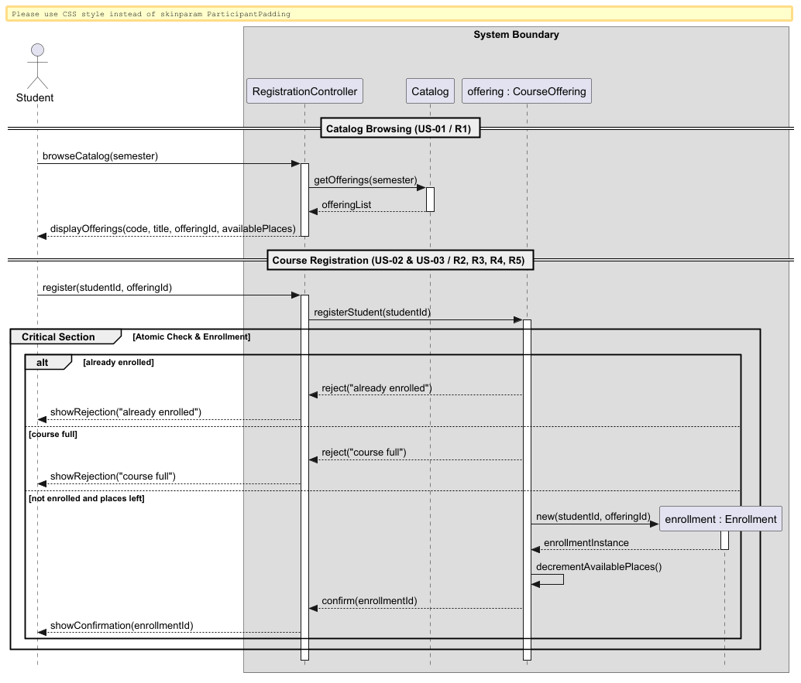
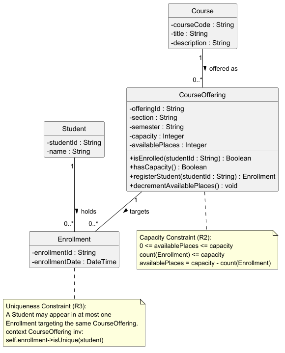
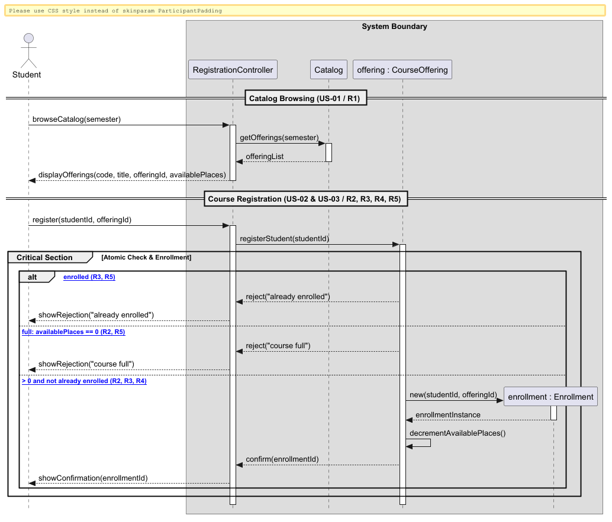
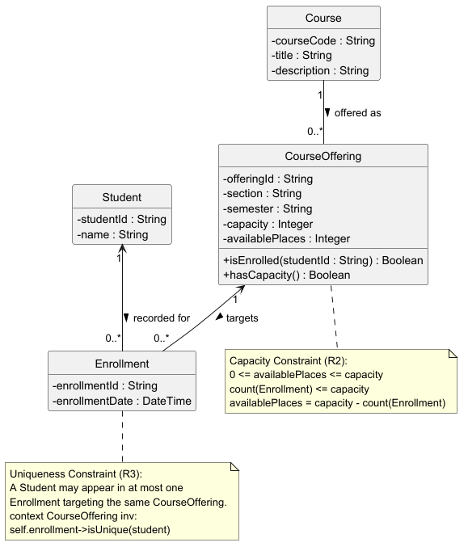

# SIS #02 — AI-Assisted UML Modeling: University Course Registration

<!--
  This is the only file you write your report in. README.md tells you what goes where.

  Rules the checker relies on:
  - Do not delete, rename or renumber the ## headings, the ### headings, or the **Label:** words.
  - Replace every "(write here)" and "(paste here)". None may be left when you submit.
  - Comments like this one are ignored by the checker and the word counter. Delete them or leave them.
-->

## 1. Scope and assumptions

<!-- Your FINAL scope statement and assumptions, after reviewing Prompt A's output. Say here
     what is out of scope (payments, prerequisites, timetable clashes, waiting lists,
     cancellation) — section 2 must not mention them. Section 10 keeps your first version. -->

**Scope:** The system covers authenticated students browsing course offerings for a specific semester and registering for a single offering with atomic capacity and duplicate checks, returning confirmation or explicit rejection, while excluding payments, prerequisites, timetable clash detection, and waitlists.

**Assumptions:**

1. The student is already authenticated, the target CourseOffering exists in the catalog, and the offering capacity is a positive integer.
2. Catalog browsing does not reserve a seat; seat reservation and duplicate validation occur atomically at the exact moment of registration.

## 2. User stories and acceptance criteria

<!-- Your APPROVED requirements: Prompt A's draft after your review. Keep the IDs, the three
     story headings and the bullet shape. Every criterion names the rule(s) it maps to,
     e.g. (R2, R4). Two criteria per story. Nothing out of scope.
     Format of a criterion, on one bullet:
     - **AC-03** (R2, R4): Given ..., When ..., Then ... -->

### US-01 — Browse offerings

**US-01:** As an authenticated student, I want to view course offerings for a chosen semester along with their current available seats, so that I can identify which sections are open and select an offering for registration.

- **AC-01** (R1): Given an authenticated student accesses the course catalog for a designated semester, When the catalog results are retrieved and displayed, Then the system displays the course code, course title, course offering identifier, and the number of currently available places for each offering in that semester.
- **AC-02** (R1, R2): Given a course offering has reached its maximum enrollment capacity, When an authenticated student views that offering in the semester catalog, Then the system displays 0 available places for that offering without reserving a seat during browsing.

### US-02 — Register for an offering

**US-02:** As an authenticated student, I want to register for an open course offering, so that I secure an enrollment place and receive proof of registration.

- **AC-03** (R2, R3, R4): Given an authenticated student is not enrolled in course offering OFF-101 and OFF-101 has at least 1 available place at the moment of request, When the student submits a registration request for OFF-101, Then the system creates exactly one Enrollment record linking the student to OFF-101, decrements the offering available places by 1, and returns a confirmation to the student.
- **AC-04** (R2, R4): Given course offering OFF-102 has exactly 1 available place remaining and the student is not currently enrolled in OFF-102, When the student submits a registration request for OFF-102, Then the enrollment succeeds, available places become 0, total enrollments equal the capacity, and a confirmation is returned.

### US-03 — Receive a clear rejection

**US-03:** As an authenticated student, I want to receive an explicit explanation if my registration cannot be completed, so that I know why the request was rejected and verify that no invalid records were created.

- **AC-05** (R2, R5): Given an authenticated student who is not enrolled in OFF-201 submits a registration request, When the system rechecks capacity and determines OFF-201 has 0 available places at that moment, Then the system rejects the request, returns the explanation course full, creates no enrollment record, and leaves the enrollment count unchanged.
- **AC-06** (R3, R5): Given an authenticated student who already has an existing enrollment record in OFF-301, When the student submits a repeat registration request for OFF-301, Then the system rejects the request, returns the explanation already enrolled, creates no duplicate enrollment, and leaves the enrollment count unchanged.

## 3. Sequence diagram

<!-- The FINAL diagram, rendered. Change .png to .svg if that is what you exported. -->



**Participants:** (write here — each lifeline and what it stands for)

**Atomic operation:** (write here — which messages form the one atomic step: the final duplicate check, the capacity check and the creation of the Enrollment, and why a catalog view reserves nothing)

**Where the Enrollment is created:** (write here — which message, which lifeline, and which class in section 4 it produces)

**Technical lifelines:** (write here — every lifeline that is NOT a class in the class diagram, by name, and why the difference in abstraction is fine. "None" if there are none.)

## 4. Class diagram

<!-- The FINAL diagram, rendered. -->



<!-- One row per association in classes.puml, read in both directions. -->

| Association | Read left to right | Read right to left |
| --- | --- | --- |
| (write here) | (write here) | (write here) |
| (write here) | (write here) | (write here) |
| (write here) | (write here) | (write here) |

**How an Enrollment links a student to an offering:** (write here)

**Capacity constraint:** (write here — and why multiplicity alone cannot express it)

**Uniqueness constraint:** (write here — and why multiplicity alone cannot express it)

## 5. Traceability

<!-- Every rule, including the catalog fields and availability (R1). Column 1: the rule and
     the criteria that cover it, e.g. "R2 + AC-03, AC-04". Column 2: the message, guard,
     class or constraint that shows the rule in YOUR diagrams. Column 3: the T-ID that
     exercises it, or the extra check you did instead (R1 has no T case). -->

| Rule and criterion | Model evidence | Validation case |
| --- | --- | --- |
| R1 + (write here) | (write here) | (write here) |
| R2 + (write here) | (write here) | (write here) |
| R3 + (write here) | (write here) | (write here) |
| R4 + (write here) | (write here) | (write here) |
| R5 + (write here) | (write here) | (write here) |

## 6. Walkthroughs

<!-- Walk each case through YOUR final sequence diagram, message by message. Column 2: the
     actual steps and the state change (count before → after). Column 3 starts with Pass or
     Fail, then the location: the message, guard or note where you saw it. A Fail you
     report honestly is a finding, not a penalty. -->

| Case | Observed path and state change | Judgment and evidence |
| --- | --- | --- |
| T1. Available | (write here) | (write here) |
| T2. Last place | (write here) | (write here) |
| T3. Full | (write here) | (write here) |
| T4. Duplicate | (write here) | (write here) |

## 7. Review decisions

<!-- At least three substantive decisions about Prompt C's critique or your own inspection.
     Decision: accepted / rejected / modified — and what you did. Reason: why, in a full
     sentence. Rule: R1–R5. Do not invent an error to fill the table; a justified rejection
     of advice counts. -->

| AI suggestion or model element | Decision | Reason | Rule |
| --- | --- | --- | --- |
| (write here) | (write here) | (write here) | (write here) |
| (write here) | (write here) | (write here) | (write here) |
| (write here) | (write here) | (write here) | (write here) |

## 8. Modeling explanation

<!-- 200–300 words. Your main design choices; how the class diagram and the sequence diagram
     complement each other; why an activity diagram could also help explain the workflow. -->

(write here)

## 9. Reflection

<!-- 150–200 words. Written by you, not by the assistant: where AI helped, one decision you
     made yourself, one remaining limitation. Specific beats flattering. -->

(write here)

## 10. Appendix A — Before AI

<!-- Written BEFORE you run Prompt A, committed and pushed in your first commit, and never
     edited afterwards. This is what you paste into Prompt A as "My initial assumptions". -->

**Scope:** The system covers authenticated students browsing course offerings for a specific semester and registering for a single offering with atomic capacity and duplicate checks, returning confirmation or explicit rejection, while excluding payments, prerequisites, timetable clash detection, and waitlists.

**Initial assumptions:**

1. The student is already authenticated, the target CourseOffering exists in the catalog, and the offering capacity is a positive integer.
2. Catalog browsing does not reserve a seat; seat reservation and duplicate validation occur atomically at the exact moment of registration.

## 11. Appendix B — AI exchanges

<!-- Complete prompts and complete responses, as text — never screenshots. Paste each inside
     the ~~~~ block that follows its label: AI responses contain ``` PlantUML blocks, and
     ~~~~ keeps them from breaking this file. Prompts B and C: the prompt text first, then
     the material it refers to ("below", "these two") pasted under it, in the same block.
     You may add B5, B6 … after B4 if you ran more. -->

### B1 — Requirements (Prompt A)

- **Tool:** Gemini
- **Model:** Gemini 3.8 Flash
- **Date:** 2026-10-17
- **Purpose:** draft 3 user stories and 6 acceptance criteria

<!-- Model: the exact model with its version, as the tool shows it (e.g. "GPT-5 Thinking",
     "Claude Sonnet 4.5"). If the tool does not show it, write: not displayed
     Date: YYYY-MM-DD -->

**Prompt:**

~~~~text
Act as a requirements analyst. Use only this course registration scenario and rules R1-R5: A student browses an electronic course catalog, chooses a course offering and requests registration. Each offering has a limited number of places. A Course describes a subject. A Course Offering is one scheduled section in one semester. Registration always targets a specific offering. Assume that the student is signed in, the selected offering exists, and its capacity is a positive whole number.
R1. Catalog: Show the course code, title, offering and available places for one semester.
R2. Capacity: Recheck current availability when registering. Enrollment must never exceed the offering's capacity.
R3. Duplicates: A student may have at most one enrollment in the same offering. Reject a repeat request.
R4. Success: Create exactly one Enrollment linking the student and offering, update availability and return a confirmation.
R5. Rejection: Explain "course full" or "already enrolled". Create no enrollment and leave the enrollment count unchanged.
Out of scope: payments, prerequisites, timetable clashes, waiting lists, cancellation.
My initial assumptions are 1. The student is already authenticated, the target CourseOffering exists in the catalog, and the offering capacity is a positive integer. 2. Catalog browsing does not reserve a seat; seat reservation and duplicate validation occur atomically at the exact moment of registration.
Draft 3 user stories and 2 Given / When / Then acceptance criteria for each. Use IDs US-01 to US-03 and AC-01 to AC-06. Map each criterion to rule IDs.
Cover normal and rejection behavior. List uncertainty separately. Do not add excluded features or invent university policies.
~~~~

**Response:**

~~~~text
### User Stories & Acceptance Criteria

#### US-01: Browse Course Offerings

* **As an** authenticated student,
* **I want to** view course offerings for a chosen semester along with their current available seats,
* **So that** I can identify which sections are open and select an offering for registration.
* **AC-01: Catalog view displaying offering details and availability**
* **Rule Mapping:** R1
* **Given** an authenticated student accesses the course catalog for a designated semester,
* **When** the catalog results are retrieved and displayed,
* **Then** the system displays the course code, course title, course offering identifier, and the number of currently available places for each offering in that semester.


* **AC-02: Reflecting zero available places when an offering is filled**
* **Rule Mapping:** R1, R2
* **Given** a course offering has reached its maximum enrollment capacity,
* **When** an authenticated student views that offering in the semester catalog,
* **Then** the system displays 0 available places for that offering without reserving a seat during browsing.


---

#### US-02: Successful Course Registration

* **As an** authenticated student,
* **I want to** register for an open course offering,
* **So that** I secure an enrollment place and receive proof of registration.
* **AC-03: Successful enrollment when capacity is available and no duplicate exists**
* **Rule Mapping:** R2, R3, R4
* **Given** an authenticated student is not enrolled in course offering `OFF-101`, and `OFF-101` has at least 1 available place at the moment of request,
* **When** the student submits a registration request for `OFF-101`,
* **Then** the system creates exactly one Enrollment record linking the student to `OFF-101`, decrements the offering's available places by 1, and returns a confirmation to the student.


* **AC-04: Atomic boundary check on the final remaining seat**
* **Rule Mapping:** R2, R4
* **Given** course offering `OFF-102` has exactly 1 available place remaining and the student is not currently enrolled in `OFF-102`,
* **When** the student submits a registration request for `OFF-102`,
* **Then** the enrollment succeeds, available places become 0, total enrollments equal the capacity, and a confirmation is returned.


---

#### US-03: Registration Rejection Handling

* **As an** authenticated student,
* **I want to** receive an explicit explanation if my registration cannot be completed,
* **So that** I know why the request was rejected and verify that no invalid records were created.
* **AC-05: Rejection due to offering capacity reached ("course full")**
* **Rule Mapping:** R2, R5
* **Given** an authenticated student who is not enrolled in `OFF-201` submits a registration request,
* **When** the system rechecks capacity and determines `OFF-201` has 0 available places at that moment,
* **Then** the system rejects the request, returns the explanation "course full", creates no enrollment record, and leaves the enrollment count unchanged.


* **AC-06: Rejection due to existing enrollment ("already enrolled")**
* **Rule Mapping:** R3, R5
* **Given** an authenticated student who already has an existing enrollment record in `OFF-301`,
* **When** the student submits a repeat registration request for `OFF-301` (regardless of offering availability),
* **Then** the system rejects the request, returns the explanation "already enrolled", creates no duplicate enrollment, and leaves the enrollment count unchanged.


---

### Areas of Uncertainty

1. **Precedence of Rejection Messages:** If a student who is *already enrolled* in an offering submits a duplicate registration request for that same offering at a moment when the offering is also *at capacity (0 available places)*, R5 specifies both "course full" and "already enrolled" as valid explanations, but does not state which condition evaluated takes priority.
2. **Catalog Semester Filtering Mechanism:** While R1 mandates showing details for "one semester," it is unspecified whether the catalog defaults to the current active semester automatically or requires an explicit semester parameter from the student before rendering.
~~~~

### B2 — UML drafts (Prompt B)

- **Tool:** Gemini
- **Model:** Gemini 3.8 Flash
- **Date:** 2026-10-17
- **Purpose:** draft the sequence and class diagrams

**Prompt:**

~~~~text
Using my approved scenario, R1-R5, stories and criteria below, return separate PlantUML code blocks for a sequence diagram and a domain class diagram.
Sequence: include catalog browsing and guarded success, full-course and duplicate outcomes. Model final checks and creation as one atomic operation.
Class: show domain concepts, useful attributes and multiplicities. State the capacity and uniqueness constraints. Explain assumptions and any technical lifelines.

Approved scenario and rules:
A student browses an electronic course catalog, chooses a course offering and requests registration. Each offering has a limited number of places. A Course describes a subject. A Course Offering is one scheduled section in one semester. Registration always targets a specific offering. Assume that the student is signed in, the selected offering exists, and its capacity is a positive whole number.
R1. Catalog: Show the course code, title, offering and available places for one semester.
R2. Capacity: Recheck current availability when registering. Enrollment must never exceed the offering's capacity.
R3. Duplicates: A student may have at most one enrollment in the same offering. Reject a repeat request.
R4. Success: Create exactly one Enrollment linking the student and offering, update availability and return a confirmation.
R5. Rejection: Explain "course full" or "already enrolled". Create no enrollment and leave the enrollment count unchanged.
Out of scope: payments, prerequisites, timetable clashes, waiting lists, cancellation.

Approved stories and criteria:
US-01: As an authenticated student, I want to view course offerings for a chosen semester along with their current available seats, so that I can identify which sections are open and select an offering for registration.
- AC-01 (R1): Given an authenticated student accesses the course catalog for a designated semester, When the catalog results are retrieved and displayed, Then the system displays the course code, course title, course offering identifier, and the number of currently available places for each offering in that semester.
- AC-02 (R1, R2): Given a course offering has reached its maximum enrollment capacity, When an authenticated student views that offering in the semester catalog, Then the system displays 0 available places for that offering without reserving a seat during browsing.

US-02: As an authenticated student, I want to register for an open course offering, so that I secure an enrollment place and receive proof of registration.
- AC-03 (R2, R3, R4): Given an authenticated student is not enrolled in course offering OFF-101 and OFF-101 has at least 1 available place at the moment of request, When the student submits a registration request for OFF-101, Then the system creates exactly one Enrollment record linking the student to OFF-101, decrements the offering available places by 1, and returns a confirmation to the student.
- AC-04 (R2, R4): Given course offering OFF-102 has exactly 1 available place remaining and the student is not currently enrolled in OFF-102, When the student submits a registration request for OFF-102, Then the enrollment succeeds, available places become 0, total enrollments equal the capacity, and a confirmation is returned.

US-03: As an authenticated student, I want to receive an explicit explanation if my registration cannot be completed, so that I know why the request was rejected and verify that no invalid records were created.
- AC-05 (R2, R5): Given an authenticated student who is not enrolled in OFF-201 submits a registration request, When the system rechecks capacity and determines OFF-201 has 0 available places at that moment, Then the system rejects the request, returns the explanation course full, creates no enrollment record, and leaves the enrollment count unchanged.
- AC-06 (R3, R5): Given an authenticated student who already has an existing enrollment record in OFF-301, When the student submits a repeat registration request for OFF-301, Then the system rejects the request, returns the explanation already enrolled, creates no duplicate enrollment, and leaves the enrollment count unchanged.
~~~~

**Response:**

~~~~text
@startuml
skinparam style strictuml
skinparam classAttributeIconSize 0
hide empty methods

class Student {
    - studentId : String
    - name : String
}

class Course {
    - courseCode : String
    - title : String
    - description : String
}

class CourseOffering {
    - offeringId : String
    - section : String
    - semester : String
    - capacity : Integer
    - availablePlaces : Integer
    + isEnrolled(studentId : String) : Boolean
    + hasCapacity() : Boolean
}

class Enrollment {
    - enrollmentId : String
    - enrollmentDate : DateTime
}

Course "1" -- "0..*" CourseOffering : offered as >
CourseOffering "1" <-- "0..*" Enrollment : targets >
Student "1" <-- "0..*" Enrollment : recorded for >

note "Capacity Constraint (R2):\n0 <= availablePlaces <= capacity\ncount(Enrollment) <= capacity\navailablePlaces = capacity - count(Enrollment)" as N_Capacity
CourseOffering .. N_Capacity

note "Uniqueness Constraint (R3):\nA Student may appear in at most one\nEnrollment targeting the same CourseOffering.\ncontext CourseOffering inv:\nself.enrollment->isUnique(student)" as N_Uniqueness
Enrollment .. N_Uniqueness

@enduml

@startuml
skinparam style strictuml
skinparam BoxPadding 10
skinparam ParticipantPadding 10

actor "Student" as student
box "System Boundary"
    participant "RegistrationController" as controller
    participant "Catalog" as catalog
    participant "offering : CourseOffering" as offering
    participant "enrollment : Enrollment" as enrollment
end box

== Catalog Browsing (US-01 / R1) ==

student -> controller : browseCatalog(semester)
activate controller

controller -> catalog : getOfferings(semester)
activate catalog

catalog --> controller : offeringList
deactivate catalog

controller --> student : displayOfferings(code, title, offeringId, availablePlaces)
deactivate controller

== Course Registration (US-02 & US-03 / R2, R3, R4, R5) ==

student -> controller : register(studentId, offeringId)
activate controller

controller -> offering : registerStudent(studentId)
activate offering

group Critical Section [Atomic Check & Enrollment]
    alt [already enrolled (R3, R5)]
        offering --> controller : reject("already enrolled")
        controller --> student : showRejection("already enrolled")

    else [offering full: availablePlaces == 0 (R2, R5)]
        offering --> controller : reject("course full")
        controller --> student : showRejection("course full")

    else [availablePlaces > 0 and not already enrolled (R2, R3, R4)]
        create enrollment
        offering -> enrollment : new(studentId, offeringId)
        activate enrollment
        enrollment --> offering : enrollmentInstance
        deactivate enrollment

        offering -> offering : decrementAvailablePlaces()
        offering --> controller : confirm(enrollmentId)
        controller --> student : showConfirmation(enrollmentId)
    end
end

deactivate offering
deactivate controller

@enduml
~~~~

### B3 — Model critique (Prompt C)

- **Tool:** Gemini
- **Model:** Gemini 3.8 Flash
- **Date:** 2026-10-17
- **Purpose:** review both models against R1–R5 and T1–T4

**Prompt:**

~~~~text
(paste here)
~~~~

**Response:**

~~~~text
(paste here)
~~~~

### B4 — Focused revision (Prompt D)

- **Tool:** Gemini
- **Model:** Gemini 3.8 Flash
- **Date:** 2026-10-17
- **Purpose:** apply my accepted review decisions

**Prompt:**

~~~~text
(paste here)
~~~~

**Response:**

~~~~text
(paste here)
~~~~

## 12. Appendix C — Original diagrams

<!-- The AI's first output from Prompt B, rendered unedited from models/original/. -->





## 13. Appendix D — References and source checks

### References

<!-- Full references, one per line, each starting with "- ". Only sources you actually opened.
     Every URL used in the source checks must also appear here. Example:
     - Sommerville, I. (2016). Software Engineering, 10th ed., Global Edition. Pearson. Ch. 5. -->

- (write here)

### Source checks

<!-- At least two modeling decisions you verified. Source and locator: title + slide, page,
     section, chapter or figure — or title + URL + access date (YYYY-MM-DD). Slide numbers
     refer to the decks posted in our Teams. -->

| Modeling decision | Source and locator | What the source says | How it supports or changed your model |
| --- | --- | --- | --- |
| (write here) | (write here) | (write here) | (write here) |
| (write here) | (write here) | (write here) | (write here) |
